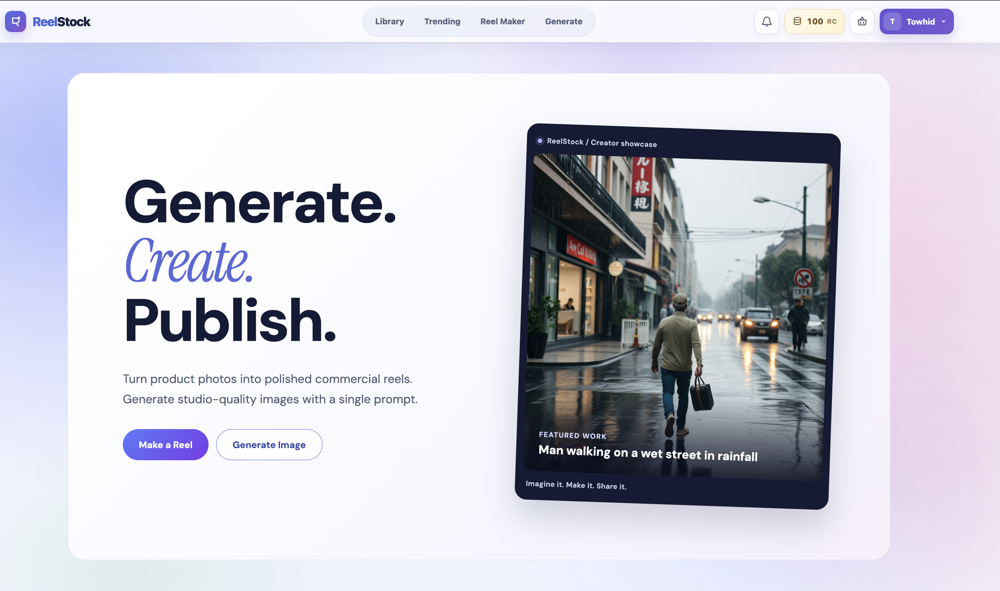
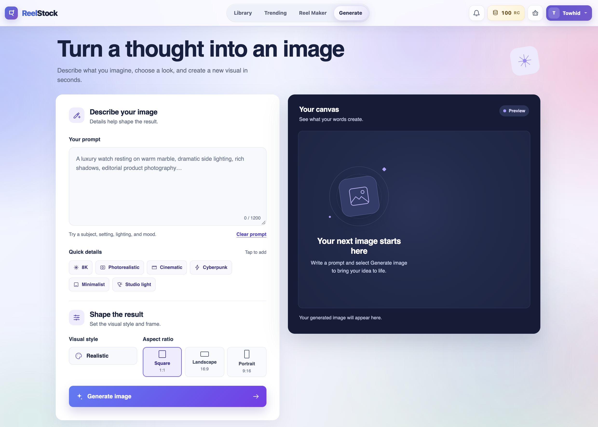
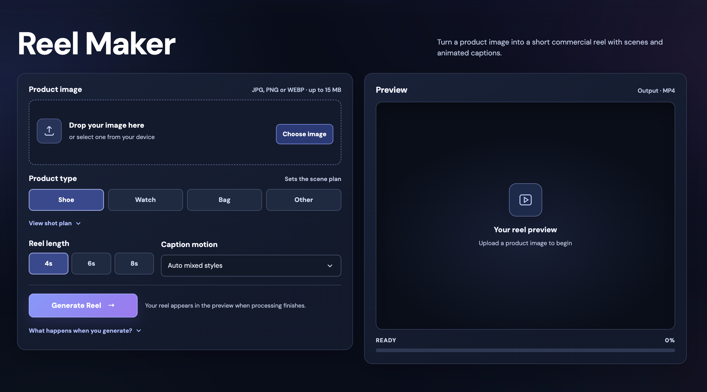
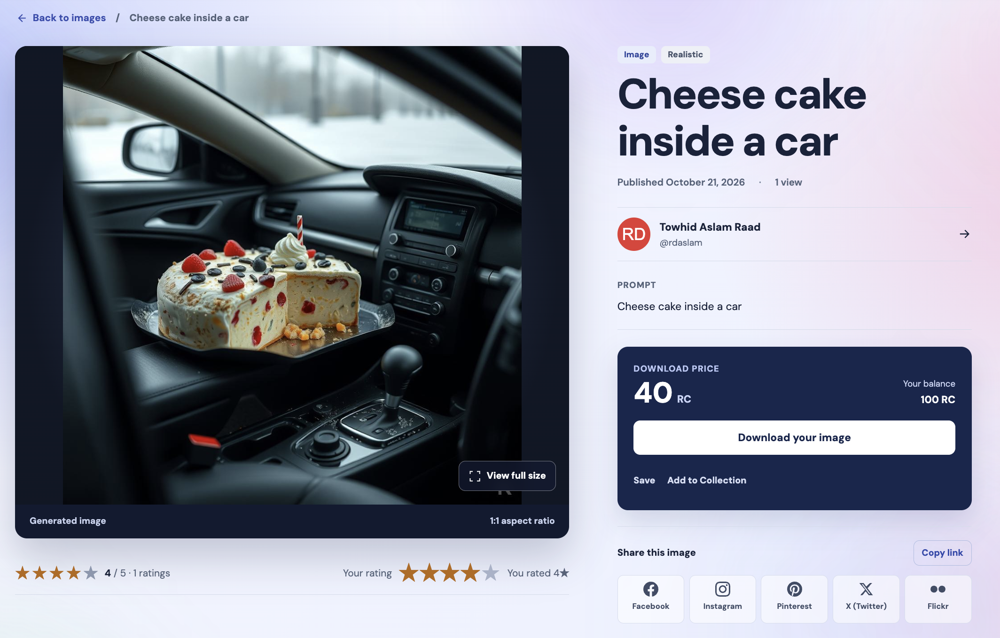
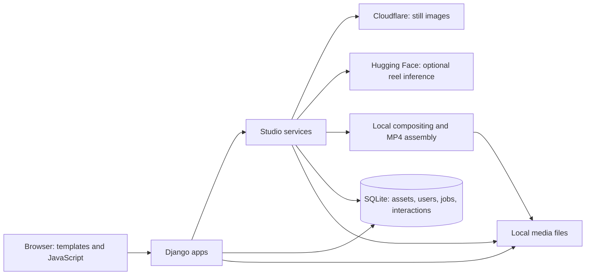

# ReelStock

Generate product images and short reels, then manage, publish, and discover reusable media in one Django platform.

Creating reusable product media is expensive and fragmented across image editing, scene creation, video composition, publishing, and asset management. ReelStock combines these steps into one AI-assisted workflow: creators generate still images from prompts or turn a product photo into a vertical reel, review the result as a draft, and publish it to a shared asset library.

The system combines hosted image inference with local compositing and video processing. Django manages asset ownership, publication, discovery, creator interactions, and platform operations around those generation paths.

## Why ReelStock

ReelStock explores the idea of a stock media platform built specifically around AI-generated content.

Generative models make it increasingly easy to create visual media, but producing useful results still often depends on knowing how to prompt, choosing the right tools, and moving content between separate generation, editing, publishing, and asset-management workflows.

ReelStock approaches this differently: creators with strong visual ideas can generate and publish media inside one platform, while users who simply need stock content can discover and download those assets without interacting with generative models themselves.

The project currently explores this idea through two generation workflows: prompt-based image generation and a low-input product Reel Maker.

## Product Preview

### Create, generate, and publish from one workspace

ReelStock brings AI generation, product-reel creation, asset management, and publishing into a single creator workflow.



### Generate images from natural-language prompts

The Image Generator connects the creative interface to Cloudflare Workers AI, turning prompts into assets that can move directly into ReelStock's draft and publishing workflow.



### Turn product images into short commercial reels

Reel Maker combines product extraction, scene composition, animated captions, transitions, and local video assembly into a configurable reel-generation workflow.



### Manage the result as a publishable media asset

Generated media becomes part of the wider platform with creator ownership, metadata, ratings, collections, sharing, and Reel Coin-based downloads.



## What ReelStock Does

- **AI still-image generation:** submit a prompt and style, generate an image through Cloudflare Workers AI, and keep it as a draft or publish it.
- **Product reel generation:** upload a product photo, choose a category, caption style, and 4, 6, or 8 second duration, then preview the assembled MP4.
- **Asset management:** review owned images and completed reels in My Assets, with publish and unpublish controls.
- **Publishing and discovery:** browse a searchable, filtered, paginated Library; explore Trending and creator profiles; collect assets in a download basket. Downloads use Reel Coins, an internal demo credit balance.
- **Creator interactions:** follow creators, rate and discuss published assets, bookmark media, and organize public or private collections.
- **Platform operations:** staff review users and assets, manage credit requests, curate featured/trending content, and inspect recorded moderation actions.

## AI & Media Pipeline

### 1. AI Image Generation

Prompt/style → Cloudflare Workers AI → FLUX.1-schnell → generated asset → draft/publish lifecycle

The image service appends the selected style to the prompt and calls the configured Workers AI model, defaulting to `@cf/black-forest-labs/flux-1-schnell`. It decodes the returned image, applies a ReelStock watermark, and saves it locally. The request handler records the result as an owned, unpublished `GeneratedImage`.

Missing credentials, timeouts, and provider errors return a clear unavailable response. This path requires a working provider; it does not substitute a placeholder image.

### 2. Product Reel Generation

Product image → background removal → scene generation → compositing → motion/transitions/captions → Pillow/OpenCV/FFmpeg assembly → MP4 → draft/publish

The reel service prepares an opening frame and five category-specific scene compositions. It reuses the uploaded product cutout, adding shadows, color grading, rim lighting, and selected reflections. Pillow, NumPy, and OpenCV render motion, transitions, template-based animated captions, and watermarks into a 576 × 1024, 24 fps video. FFmpeg then attempts H.264 encoding with browser-oriented playback settings.

Reel processing has explicit fallbacks:

- Background removal tries optional local `rembg`, then the configured Hugging Face background-removal endpoint, then OpenCV GrabCut. A failed GrabCut segmentation can retain the original foreground.
- Scene generation still uses Hugging Face inference when configured, with FLUX.1-schnell as its default model. Missing credentials or failed scene requests produce local gradient backgrounds with texture and lighting; the job records that fallback for the creator.
- If FFmpeg transcoding fails, the OpenCV MP4 is retained; browser codec support may vary.

Views handle validation and ownership; `studio/services/` contains provider requests, image processing, and pipeline orchestration. Reel status is stored in SQLite and polled by the browser.

## Architecture

ReelStock is a Django monolith with five application boundaries:

| Application | Responsibility |
| --- | --- |
| `core` | Shared asset/profile/social models, account flows, homepage, and blog |
| `studio` | Generation endpoints, provider services, reel orchestration, and publication controls |
| `libraryapp` | Asset browsing, public detail pages, creator interactions, collections, and Trending |
| `wallet` | Demo credits, transaction records, download basket, and ZIP delivery |
| `moderation` | Staff sessions, asset/user review, curation, credit approvals, and action logs |



## Engineering Highlights

- **Service boundaries:** provider calls and media processing are isolated from Django views, with a small image-provider interface and separate reel stages.
- **Failure handling:** provider timeouts, scene fallbacks, persistent reel status, server-side exception logging, and concise user-facing errors.
- **Publication controls:** new assets start unpublished; owner-scoped publication endpoints and public queries restrict discovery to published assets and completed reels.
- **Input and access validation:** image-content verification, a 15 MB upload limit, supported duration/category checks, authentication requirements, and private-collection access checks.
- **Account flows:** Django password validation, safe post-login redirects, and Google OAuth through django-allauth and Sites.
- **Discovery:** server-side pagination, search and category filters, with Trending based on recent engagement and staff overrides.
- **Platform operations:** staff access controls, moderation action records, and credit-request review. Download ZIPs are prepared before credits are debited, so unavailable files do not incur a charge.
- **Configuration and tests:** environment-based provider settings and Django tests covering generation, publication, access, social interactions, credits, and moderation.

## Tech Stack

| Layer | Implementation |
| --- | --- |
| Backend | Python, Django 4.2, Django ORM |
| AI / ML / Media | Cloudflare Workers AI with FLUX.1-schnell; optional Hugging Face reel inference and `rembg`; Pillow, NumPy, OpenCV, FFmpeg via system installation or `imageio-ffmpeg` |
| Frontend | Django templates, Bootstrap 5.3, custom CSS, vanilla JavaScript |
| Authentication | Django sessions/password authentication, django-allauth Google OAuth, Django Sites |
| Data / Storage | SQLite and local filesystem media |
| Testing | Django test runner, Python `unittest.mock`, temporary media directories |

## Repository Structure

```text
reelstock/           Django settings and URL configuration
core/                Shared models, accounts, homepage, blog, migrations
studio/
  services/          Inference, background removal, compositing, reel assembly
libraryapp/          Discovery and creator interactions
wallet/              Demo credits and downloads
moderation/          Staff operations and audit records
templates/           Server-rendered pages
static/              CSS, JavaScript, and static assets
docs/                Architecture documentation
.env.example         Local configuration template
requirements.txt     Python dependencies
```

## Local Setup

Use Python 3.10+ and a virtual environment. From the repository root:

```bash
python -m venv .venv
source .venv/bin/activate
python -m pip install -r requirements.txt
cp .env.example .env
```

On Windows, activate with `.venv\Scripts\activate`. Set `DJANGO_SECRET_KEY` in `.env`. Configure the still-image provider with:

| Variable | Purpose / default |
| --- | --- |
| `CLOUDFLARE_ACCOUNT_ID` | Cloudflare account ID |
| `CLOUDFLARE_AI_TOKEN` | API token permitted to run Workers AI inference |
| `CLOUDFLARE_IMAGE_MODEL` | `@cf/black-forest-labs/flux-1-schnell` |
| `CLOUDFLARE_IMAGE_TIMEOUT` | Request timeout in seconds; `90` |

Optional reel inference uses `HF_API_TOKEN`, `HF_IMAGE_MODEL` (default `black-forest-labs/FLUX.1-schnell`), and `HF_IMAGE_TIMEOUT` (default `60` seconds). Without this configuration, reels use local scene backgrounds and local background removal. Install `rembg` separately if desired; it downloads a model on first use. The assembler looks for system FFmpeg before using the executable supplied by `imageio-ffmpeg`.

```bash
python manage.py migrate
python manage.py createsuperuser
python manage.py runserver
```

Open `http://127.0.0.1:8000/`. Register or sign in, then use **Generate** for still images or **Reel Maker** for product videos. Review output in **My Assets**, publish it, and browse it in the **Library**. Staff tools are at `/admin-panel/`; Django administration is at `/admin/`.

For Google sign-in, configure the Site selected by `DJANGO_SITE_ID` (default `1`) and attach a Google SocialApp with existing client credentials through Django admin. For the development address above, authorize `http://127.0.0.1:8000/accounts/google/login/callback/` in Google Cloud. OAuth credentials live in the local database, not `.env.example`.

`db.sqlite3`, `.env`, and `media/` are local state excluded from Git. Preserve them when updating an existing checkout; a fresh database starts without application data or SocialApp configuration.

## Testing

```bash
python manage.py check
python manage.py test
```

The suite covers account validation and Google routing, owned draft creation and publishing, upload validation, reel submission and failure handling, Library pagination and draft filtering, social/collection access, download charging, and staff moderation. Provider calls and job startup are mocked where needed; these tests do not establish live provider availability or full video-render quality.

## Current Architecture Scope

The current implementation runs as a single Django application with SQLite, local media storage, and local CPU-based video processing. Still-image inference runs during the HTTP request; each reel job runs in an in-process daemon thread while the browser polls its database status. Jobs depend on the application process remaining alive and have no durable queue or automatic retry mechanism.

The checked-in settings target local development (`DEBUG=True`, permissive hosts, and Django-served media). Publication rules govern application pages; local media URLs are not protected by per-file authorization. A public deployment needs explicit host/security settings, appropriate media access and serving, and backups of both SQLite and media. Provider integration includes configurable models/timeouts, logging, and fallbacks; model training, experiment tracking, and a model registry are outside the current implementation.

### Reel Maker: Current Design Tradeoff

The current Reel Maker is intentionally built around deterministic image processing, compositing, and local video assembly rather than relying entirely on a commercial text-to-video or image-to-video model.

This creates a tradeoff. The resulting videos do not match the visual realism or motion quality of the latest commercial video-generation systems, but the pipeline is considerably more controllable, inexpensive to experiment with, and suitable for demonstrating the complete product workflow without requiring costly inference for every generation.

The interface is designed around minimizing prompting. A creator uploads a product, selects its category, adjusts a small number of parameters, and the system handles the remaining generation steps.

This also leaves a clear path for future expansion. A stronger video model could replace or augment parts of the rendering pipeline while keeping the same user workflow. Product category, visual settings, caption style, and other structured inputs could be translated internally into engineered prompts and generation instructions, allowing more capable models to improve output quality without exposing prompt engineering complexity to the user.

## Future Direction

The current implementation focuses on proving the end-to-end product workflow rather than maximizing generative model quality.

A natural next step would be a hybrid Reel Maker in which local processing remains responsible for deterministic tasks such as product isolation, metadata, captions, publishing, and asset management, while selected scene or motion-generation stages are delegated to more capable video models.

This would preserve ReelStock's low-input user experience while allowing the quality of generated product reels to improve as video-generation models become more accessible and cost-effective.

## Documentation

See [Architecture](docs/ARCHITECTURE.md) for service boundaries, generation flows, persistence, and operational assumptions.
